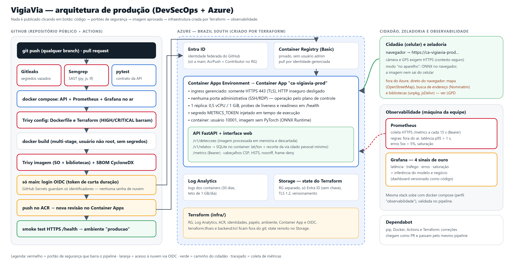

# VigiaVia — MVP em produção (Secure DevOps & Cloud)

> **Deploy Blindado** · FIAP Global Solution 2026.2 · CitizenTech · Engenharia de Software 4º ano (4ES)
> Disciplina **Secure DevOps Tools & Cloud Computing** (Profs. Gabriel Arcanjo e Cleórbete Santos)

[](https://github.com/akiramrt/vigiavia-mvp/actions/workflows/devsecops.yml)

**🌐 MVP no ar:** https://ca-vigiavia-prod.happywave-0bf5b4c3.brazilsouth.azurecontainerapps.io · 📄 [Relatório da disciplina (PDF)](docs/relatorio/VigiaVia_Secure_DevOps.pdf) ·
🧠 [Componente de visão computacional](https://github.com/akiramrt/vigiavia-visao-computacional)

| Integrante | RM |
|---|---|
| Deivison Pertel | 550803 |
| Eduardo Akira Murata | 98713 |
| Wesley Souza de Oliveira | 97874 |

## Ficha técnica do MVP

| Item | VigiaVia |
|---|---|
| **Nome do produto** | VigiaVia — zeladoria inteligente de vias públicas |
| **Cidadão e território** | Quem circula pelas vias (motociclistas, ciclistas, pedestres, motoristas, usuários de ônibus) e os agentes de zeladoria das subprefeituras. Piloto: centro de São Paulo (Bela Vista). |
| **Problema, em uma frase** | Buracos nas vias causam acidentes e custos, e sua identificação depende de chamados manuais, lentos, imprecisos e duplicados (113,1 mil pedidos de tapa-buraco em SP em 2025). |
| **Proposta de valor** | Detectar buracos automaticamente com as câmeras que já circulam pela cidade e entregar à zeladoria um relato único, georreferenciado e priorizado por buraco — com privacidade e validação humana. |
| **Arquitetura: componentes** | API FastAPI + interface web (cidadão e zeladoria) · detector YOLO26n em ONNX Runtime · fila de relatos com deduplicação geográfica · Azure Container Apps + ACR + Log Analytics (Terraform) · pipeline DevSecOps (GitHub Actions) · Prometheus + Grafana. |
| **Fontes de dados** | RDD2022 (treino do modelo, CC BY-SA 4.0); relatos e detecções enviados pelos cidadãos; dados de demonstração simulados na Bela Vista (sinalizados como `demonstracao`). |
| **Modelos de IA utilizados** | YOLO26n treinado no RDD2022 (mAP@0,5 = 0,585 no teste), exportado para ONNX; executado no servidor (ONNX Runtime) ou no navegador (onnxruntime-web). |
| **URL do MVP e repositório** | https://ca-vigiavia-prod.happywave-0bf5b4c3.brazilsouth.azurecontainerapps.io · https://github.com/akiramrt/vigiavia-mvp |
| **Indicadores de impacto** | Tempo entre detecção e reparo · % de chamados duplicados evitados · buracos detectados por km rodado · precisão das detecções confirmadas pela zeladoria. Operação: disponibilidade, p95 de latência, taxa de erros e saturação (4 sinais de ouro). |
| **ODS conectados** | ODS 11 (11.2, 11.3) · ODS 9 (9.1) · ODS 3 (3.6) |

## Arquitetura



| Camada | Como foi feito | Por quê |
|---|---|---|
| **Container** | [`Dockerfile`](Dockerfile) multi-stage, `python:3.12-slim`, usuário 10001, `HEALTHCHECK`, sem PyTorch | imagem pequena = menos vulnerabilidades e deploy rápido; nenhum segredo na imagem |
| **Stack local** | [`docker-compose.yml`](docker-compose.yml): API (read-only, `cap_drop: ALL`, `no-new-privileges`) + Prometheus + Grafana (presos a `127.0.0.1`) | mesma stack para desenvolver e para observar; validada a cada push no pipeline |
| **Nuvem (IaC)** | [`infra/`](infra) — Terraform: RG, Log Analytics, ACR, identidades gerenciadas, RBAC, Container Apps, OIDC | nada criado à mão; state remoto no Azure Storage (Entra ID, sem chave); `.tfvars` e `backend.hcl` fora do git |
| **Rede** | ingress gerenciado **somente HTTPS**; **nenhuma porta administrativa** (SSH/RDP) existe | não há porta admin para abrir a `0.0.0.0/0` — a operação é feita pelo plano de controle do Azure, autenticado e auditado |
| **Pipeline** | [`.github/workflows/devsecops.yml`](.github/workflows/devsecops.yml): Gitleaks · Semgrep · pytest · compose · Trivy (config e imagem) · SBOM · push no ACR · deploy · smoke test | cada push passa pelos portões; deploy só da `main`, via OIDC (sem senha de nuvem) |
| **Observabilidade** | [`observabilidade/`](observabilidade): métricas na API (`/metrics` com Bearer), alertas Prometheus, dashboard Grafana como código | latência, tráfego, erros e saturação + inferência e negócio |

## Como executar

### Local (Docker)
```bash
python scripts/preparar_segredos.py        # gera .env e o token do Prometheus (fora do git)
docker compose up -d --build               # API em http://localhost:8000
docker compose --profile observabilidade up -d   # + Prometheus :9090 e Grafana :3000 (só localhost)
```

### Testes e portões de segurança (os mesmos do pipeline)
```bash
pip install -r requirements-dev.txt && pytest -q
gitleaks dir . && trivy config . --severity HIGH,CRITICAL && semgrep scan --config p/python --config p/javascript --config p/secrets --config p/dockerfile --config p/terraform --error
```

### Infraestrutura (Azure, uma vez)
```bash
az login && az account set -s <assinatura>
bash infra/bootstrap/criar_backend.sh brazilsouth           # state remoto (Storage + Entra ID)
python scripts/preparar_segredos.py --subscription <assinatura>   # infra/terraform.tfvars (fora do git)
cd infra && terraform init -backend-config=backend.hcl && terraform plan -out=plano.tfplan
terraform apply plano.tfplan                                 # aplicado por uma pessoa, após revisar o plano
```
Depois, cadastre em **Settings → Secrets and variables → Actions** os valores de `terraform output`:
`AZURE_CLIENT_ID`, `AZURE_TENANT_ID`, `AZURE_SUBSCRIPTION_ID`, `ACR_NOME`, `ACA_NOME`, `AZURE_RG` (secrets) e
`PUBLICAR_IMAGEM=true`, `DEPLOY_HABILITADO=true` (variables). A partir daí todo push na `main` é implantado.

### Observabilidade apontando para a nuvem
```bash
python scripts/preparar_segredos.py --fqdn <fqdn do terraform output>
docker compose --profile observabilidade up -d
python scripts/gerar_carga.py --url https://ca-vigiavia-prod.happywave-0bf5b4c3.brazilsouth.azurecontainerapps.io --concorrencia 16 --duracao 300   # dispara o alerta de latência
```

## Custos (preços reais, Brazil South)

`python scripts/estimar_custo.py` consulta a Azure Retail Prices API e a PTAX do Banco Central:
**MVP ≈ US$ 15,61/mês (R$ 85,53)** — coberto pelo crédito do Azure for Students. Detalhes em [`docs/custos.json`](docs/custos.json).

## Segurança e LGPD (resumo)

* **Segredos:** nenhum no código, na imagem ou no state versionado; `METRICS_TOKEN` entra como segredo do Container App;
  o GitHub usa OIDC (identidade federada) — não há senha de nuvem para vazar.
* **Dados pessoais:** a API **não guarda imagens enviadas**; um relato guarda só lat/lon, severidade e o recorte da via
  (SQLite dentro do container, região Brazil South). Logs da plataforma no Log Analytics por 30 dias.
* **Responsabilidade compartilhada:** Microsoft cuida do hardware, rede física, hipervisor, plataforma do Container Apps,
  TLS do ingress; a equipe cuida do código, da imagem e suas dependências, identidades/RBAC, segredos, dados e configuração.

## Licença
Código sob **AGPL-3.0**. Modelo treinado com Ultralytics YOLO (AGPL-3.0) sobre o RDD2022 (CC BY-SA 4.0).
